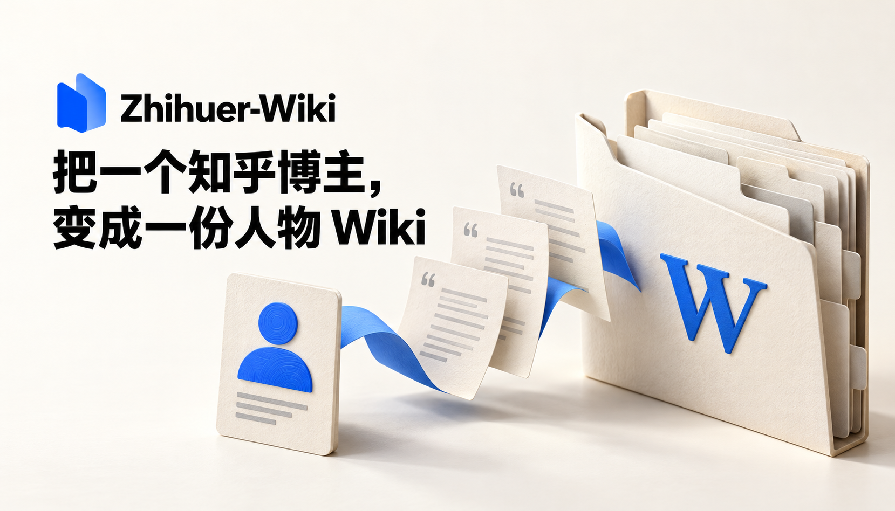

<h1 align="center">Zhihuer-Wiki</h1>

<p align="center"><strong>把一个知乎博主，变成一份人物 Wiki。</strong></p>
<p align="center">给 Agent 一个主页，拿回有原话、有时间、有出处的知识文件夹。</p>

<p align="center">
  
  
  
  
</p>



<p align="center">
  <a href="#features">能做什么</a> ｜
  <a href="#start">快速开始</a> ｜
  <a href="#agent">直接交给 Agent</a> ｜
  <a href="#architecture">如何工作</a> ｜
  <a href="#limits">当前边界</a>
</p>

Zhihuer-Wiki 是一个开源、在本地运行的人物 Wiki 构建工具。从知乎回答、文章和想法中提取观点条目，再组织成可逐层阅读的主题与子页。原文始终保留，概括始终带着出处。

**模型工作交给你已有的 Codex 或其他编程 Agent。** 项目负责爬取、切批、准备任务、核验和导出，不需要配置 LLM API key，不启动 PersonClone，也不需要 Qdrant。使用 Agent 仍会消耗它的订阅额度或相应费用。

<a id="features"></a>

## ✨ 能做什么

### 📥 一个主页，整理成一份文件夹

输入知乎主页网址或 URL token，抓取公开可访问的回答、文章和想法。已有 Markdown 也能直接导入。登录状态保存在自己的电脑上，模型任务只接收需要处理的材料。

### 🧭 先保住原话，再组织人物知识

一篇材料可以产生多条条目。每条保留转述、代表原话、时间、条件和原文出处，再由 Agent 完整细分类。相反观点和不同时间的表达都会保留，不强行揉成一个中立结论。

人物概览 → 主题页 → 主题子页 → 条目 → 原文。目录提供阅读入口，完整条目提供证据，原文提供核查。普通 Markdown 编辑器、Obsidian 和能读文件的 Agent 都可以使用。

### 🔁 每批有检查点，失败能接着做

默认每批最多十篇原文、约两万估算 token，以先达到的上限为准；长文分段处理，保留完整源文件。条目提取完再候选分组，Agent 对全部条目做细分类。通过核验的任务可复用，失败结果保留供检查。

### 📦 输出归你，不被运行器锁住

交付包括 `wiki/index.md`、主题与子页、逐条证据、原文档案和 `wiki/readable.md`。阅读版可作为数字分身的上下文；目录与链接可供 Agent 按需追溯。项目当前负责建库，不内置回答生成器或在线 Wiki Search。

<a id="start"></a>

## 🚀 快速开始

准备 Python **3.11+**、Git，以及能正常使用的 Codex CLI 或其他编程 Agent。首次下载可选本地 embedding 模型需要网络。

已经能在终端使用 Codex，可以直接：

```powershell
git clone https://github.com/SlamWeb/Zhihuer-Wiki.git
cd Zhihuer-Wiki
python run.py https://www.zhihu.com/people/你的URL-token --max-items 10
```

`run.py` 自动创建项目 `.venv` 并安装依赖，之后等价于执行下面的构建命令。
默认包含语义聚类依赖，首次安装可能较慢；先做小样本可显式加 `--grouping none`。
需要登录知乎时按下方说明操作。想自己管理环境，使用分步方式：

### 1. 下载与安装

```powershell
git clone https://github.com/SlamWeb/Zhihuer-Wiki.git
cd Zhihuer-Wiki
python -m venv .venv
.\.venv\Scripts\python.exe -m pip install -e .
```

Linux/macOS 将 Python 路径换成 `.venv/bin/python`。后续命令始终使用刚安装项目的同一个解释器。

### 2. 输入知乎主页

先用少量材料跑通：

```powershell
.\.venv\Scripts\python.exe -m zhihuer_wiki build https://www.zhihu.com/people/你的URL-token --max-items 10
```

默认使用本机已经登录的 Codex CLI，逐批执行提取、分类与概览任务。可选 `--model` 透传你本机可用的模型；不指定则使用 Codex 当前配置。需要完整抓取时去掉 `--max-items`。

这里的“用户名”是主页地址里的 URL token，例如 `/people/wu-ren-jun-28` 中的 `wu-ren-jun-28`；显示昵称不能唯一确定账号。

若尚未安装或登录 Codex CLI，先按[官方说明](https://learn.chatgpt.com/docs/non-interactive-mode)完成配置，或使用下面的 Agent Skill 入口。CLI 会复用现有登录态；没有模型可用时会明确失败，不生成假 Wiki。

### 3. 抓取遇到登录限制时

```powershell
.\.venv\Scripts\python.exe -m zhihuer_wiki login
```

在弹出的浏览器里自行登录知乎，再重复构建命令。优先复用已安装 Chrome/Edge；没有可用浏览器时运行：

```powershell
.\.venv\Scripts\python.exe -m playwright install chromium
```

状态默认存在 `.local/auth/zhihu_storage_state.json`，不需要把 Cookie 粘贴给模型。平台限制、验证码或登录过期仍可能阻止抓取。

### 4. 打开结果

```text
outputs/<URL-token>/wiki/index.md
outputs/<URL-token>/wiki/readable.md
```

核验结果：

```powershell
.\.venv\Scripts\python.exe -m zhihuer_wiki validate --workspace outputs/你的URL-token
```

<a id="agent"></a>

## 🪄 直接交给 Codex 或其他 Agent

在克隆后的仓库打开 Agent，发送：

```text
读取 .agents/skills/zhihuer-wiki/SKILL.md，
把 https://www.zhihu.com/people/你的URL-token 做成一份 Persona Wiki。
先处理最多10篇，完成后核验并给我 index.md 和 readable.md。
```

Codex 可发现仓库内的 [zhihuer-wiki Skill](.agents/skills/zhihuer-wiki/SKILL.md)。其他能执行命令、读写文件的 Agent 也能直接读取同一份说明。该入口使用**当前 Agent**做模型工作，不需要额外启动 Codex CLI。

已有爬取材料：

```powershell
.\.venv\Scripts\python.exe -m zhihuer_wiki build 你的URL-token --raw-dir ./my-raw --agent manual
```

然后让当前 Agent 循环执行 `next` → 读取完整输入 → 写响应 → `submit`，直到完成。模型结果经过同样的原话、ID覆盖和引用核验。

中断后继续：

```powershell
.\.venv\Scripts\python.exe -m zhihuer_wiki resume --workspace outputs/你的URL-token
```

不需要登录知乎的练习材料在 [samples/demo-raw](samples/demo-raw)，全部为虚构文本。用 `--raw-dir samples/demo-raw` 导入，仍需真实 Agent 做语义提取，示例不会冒充真实抓取结果。

<a id="architecture"></a>

## ⚙️ 如何工作

```text
知乎主页 / 已有 Markdown
         ↓
    原文快照与出处
         ↓
  分批完整提取带原话的条目
         ↓
  本地向量 + KMeans 候选预分组
         ↓
  Agent 完整细分类，形成具体子页
         ↓
  整理父级主题，生成带依据的概览
         ↓
  核验并导出 Markdown Wiki
```

**KMeans 负责把可能接近的条目放在一起，Agent 负责理解它们。** K不是最终页数，聚类结果不能直接当人物知识结构。小于或等于200条时跳过数值预分组，直接完整分类。较大语料默认使用本地多语言 embedding；需要时安装：

```powershell
.\.venv\Scripts\python.exe -m pip install -e ".[semantic]"
```

模型默认 `sentence-transformers/paraphrase-multilingual-MiniLM-L12-v2`，可通过 `--embedding-model` 修改。希望更轻量时，显式 `--grouping tfidf` 使用字符 TF-IDF 候选聚类；它是词面分组，不声称等同语义向量。`--grouping none` 可跳过预分组。

**子页讨论具体问题，父级负责导航。** “网课中的课堂管理”和“教育资源的接入条件”可以同属教育主题，但不会仅因相近就合成一个大页。全局整理保留子页，不在目录阶段覆盖条目。

**核验检查结构与出处，不替人物裁定价值观。** 检查原话确实存在、每篇材料有处理结果、每条有主归属、链接和依据ID有效。语义是否完整、是否真正理解人物，仍有模型判断的局限。

### 本地文件放在哪里？

| 位置 | 内容 |
| --- | --- |
| `.local/auth/` | 自己的知乎浏览器登录状态 |
| `outputs/<作者>/raw/` | 爬取的 Markdown 与 manifest |
| `outputs/<作者>/evidence/` | 原文快照、已接受条目与任务响应 |
| `outputs/<作者>/derived/` | 候选分组、子页、目录与概览中间结果 |
| `outputs/<作者>/.work/` | 任务输入、Schema、检查点与Agent日志 |
| `outputs/<作者>/wiki/` | 可单独带走的 Wiki 文件夹 |
| `samples/demo-raw/` | 明确标注为虚构的公开示例 |

输出、原文、登录态和模型缓存不随 Git 分发。更多结构与更新边界见 [工作流说明](docs/workflow.md)。

<a id="limits"></a>

## 🧭 当前边界

- **抓取范围**：只能处理本机当前可访问的内容；限量或部分抓取会保留范围报告，不承诺获得某位博主的全部历史。
- **模型质量**：核验能拒绝编造引文和丢失归属，不能证明转述与分类始终正确。人物 Wiki 是来源绑定的整理结果，不是经过本人确认的人格档案。
- **更新**：同一工作区用于断点恢复。原文变更或增加材料先构建到新的 `--out`；本版不实现跨版本局部语义合并，避免把旧观点悄悄覆盖。
- **阅读与搜索**：产物提供链接与层次，尚无内置 Agentic Search 或生成质量评估，也没有接入任何 LLM API provider。
- **使用成本**：不另收模型API费用不等于免费推理；Agent额度、本地模型下载与计算成本仍由自己的环境承担。

## 📚 深入了解

- [构建工作流与文件结构](docs/workflow.md)
- [Agent Skill](.agents/skills/zhihuer-wiki/SKILL.md)
- [项目契约](SPEC.md)
- [验证记录](docs/verification.md)
- [PersonClone](https://github.com/SlamWeb/PersonClone)：本项目的爬取与人物 Wiki 思路来源。

开发验证：`python -m pip install -e ".[dev]"`，再运行 `python -m pytest -q`。离线测试使用虚构语料与受控响应；真实知乎抓取和真实 Agent 推理的验证单独记录。
